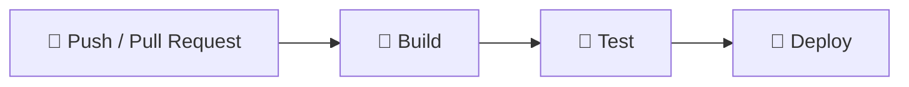

<div align="center">

# 🚀 Зертханалық жұмыс № 9
### CI/CD негіздері: GitHub Actions көмегімен үздіксіз интеграция және жеткізу


👩‍💻 **Орындаған:** Мөлдір және Аяулым

</div>

---

## 🎯 Жұмыстың мақсаты

- CI/CD (Continuous Integration / Continuous Delivery) ұғымымен танысу;
- GitHub Actions көмегімен **кодты тексеру**, **жобаны жинау (build)** және **орналастыру (deploy)** процестерін автоматтандыру.

## 📚 Қысқаша теория

| Термин | Мағынасы |
|---|---|
| **CI** | Кодқа өзгеріс енгізген сайын автоматты түрде тексеру |
| **CD** | Тексерілген кодты дайын ортаға автоматты түрде жеткізу |
| **Pipeline** | CI/CD қадамдарының реттелген тізбегі |
| **GitHub Actions** | GitHub ішіндегі автоматтандыру құралы |

## 🔄 Pipeline схемасы



## 📁 Жоба құрылымы

```text
lab9-cicd/
├── .github/
│   └── workflows/
│       └── ci-cd.yml      ← CI/CD pipeline файлы
├── screenshots/           ← есепке арналған скриншоттар
├── index.html             ← HTML жобасы
├── .gitignore
└── README.md
```

---

## 🛠️ Орындау жолы (қадам-қадам)

### 0️⃣ Дайындық
1. **Git** пен **VS Code** орнатылған болуы керек. Тексеру: терминалға `git --version` деп жазыңыз.
2. github.com сайтында аккаунт болуы керек.
3. ZIP-ті ашып, VS Code-та: **File → Open Folder** → `lab9-cicd` папкасын таңдаңыз.
4. Терминал ашу: **Ctrl + `** (немесе **Terminal → New Terminal**).

### 1️⃣ Репозиторий құру — 👩‍💻 Мөлдір
1. github.com → **New repository** → атауы `lab9-cicd` → **Public**.
2. README және .gitignore қосу белгілерін **қоспаңыз** → **Create repository**.
3. **Settings → Collaborators → Add people** арқылы Аяулымды шақырыңыз.

### 2️⃣ Жобаны GitHub-қа жіберу — 👩‍💻 Мөлдір
`ci-cd.yml` файлы дайын тұр, сондықтан тікелей жібереміз:

```bash
git init
git branch -M master
git add .
git commit -m "CI/CD workflow қосылды"
git remote add origin https://github.com/ЛОГИН/lab9-cicd.git
git push -u origin master
```

> 💡 Git аты-жөніңізді сұраса:
> ```bash
> git config --global user.name "Аты-жөніңіз"
> git config --global user.email "поштаңыз@mail.com"
> ```

### 3️⃣ CI процесін тексеру — 👩‍💻👩‍💻 екеуі де
1. GitHub-тағы репозиторий бетіне өтіңіз.
2. **Actions** қойындысын ашыңыз.
3. **CI/CD Pipeline** іске қосылғанын және жасыл белгімен (✅) аяқталғанын тексеріңіз.

📸 **Скриншот № 1** — `screenshots/1-actions-build.png`

### 4️⃣ Pull Request арқылы тексеру — 👩‍💻 Аяулым
```bash
git clone https://github.com/ЛОГИН/lab9-cicd.git
cd lab9-cicd
git checkout -b feature-ayaulym
```
`index.html` файлында кішкене өзгеріс жасаңыз (мысалы, мәтінді өзгертіңіз), сосын:

```bash
git add .
git commit -m "Аяулым өзгеріс енгізді"
git push origin feature-ayaulym
```
GitHub-та **Compare & pull request** → **Create pull request** басыңыз. Төменде автоматты тексерулер (Checks) көрінеді.

📸 **Скриншот № 2** — `screenshots/2-pull-request.png`

Содан кейін **Merge pull request** батырмасын басыңыз.

### 5️⃣ CD қадамын тексеру — 👩‍💻👩‍💻 екеуі де
Merge-ден кейін `master` тармағында pipeline қайта іске қосылады.
**Actions** → соңғы іске қосуды ашыңыз → **екі job** орындалуы керек:

- ✅ `build`
- ✅ `deploy`

📸 **Скриншот № 3 (ең маңыздысы)** — `screenshots/3-build-deploy.png`

---

## ✅ Тапсыруға арналған тізім

- [ ] `.github/workflows/ci-cd.yml` файлы репозиторийде бар
- [ ] Push кезінде pipeline автоматты түрде іске қосылды
- [ ] Pull Request кезінде де pipeline іске қосылды
- [ ] `build` және `deploy` job-тары сәтті өтті
- [ ] 3 скриншот `screenshots/` папкасында
- [ ] Репозиторий сілтемесі мұғалімге жіберілді

## 🩺 Ықтимал қателер мен шешімдері

| Мәселе | Шешімі |
|---|---|
| Pipeline іске қосылмады | Папка атауы дәл `.github/workflows` екенін және тармақ `master` (немесе `main`) екенін тексеріңіз |
| Қызыл белгі ❌ | Actions бетінде қай қадам құлағанын ашып қараңыз; `ci-cd.yml` ішіндегі бос орындарды (отступ) тексеріңіз |
| `git push` құпиясөз сұрайды | Құпиясөздің орнына **Personal Access Token** керек (GitHub → Settings → Developer settings) немесе браузер арқылы кіріңіз |

---

<div align="center">

Жасаған: **Мөлдір** & **Аяулым** · 2026

</div>
